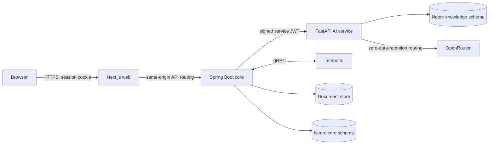

# Architecture

The target architecture. It is built milestone by milestone, and [progress.md](progress.md) records what exists. Reasons for each choice are in [decisions.md](decisions.md); process-level flows are in [system-flows.md](system-flows.md).

## System overview

## Service boundaries

| Component | Owns | Must not |
|---|---|---|
| **Web** | Presentation and user flows | Hold authorization logic; call the AI service; see secrets |
| **Core** | Identity, RBAC, claims, policy records, documents, reviews, audit, workflows, AI result records | Call model providers; perform AI processing |
| **AI** | Extraction, policy knowledge, retrieval, Policy Agent, risk analysis, model access | Accept user traffic; read `core`; hold document storage credentials; call core |
| **Temporal** | Durable execution state | Store claim content: payloads carry IDs only |

Dependencies point one way: web → core → AI. The AI service never calls back, which keeps the trust model simple and avoids distributed cycles.

### Core: modular monolith

One deployable with feature packages (`identity`, `audit`, `policy`, `claim`, `document`, `intelligence`, `review`, `workflow`, `aiclient`, `system`, `platform`). Modules use each other's public APIs only, and ArchUnit tests enforce this. The domain does not justify more microservices.

### AI: stateless pipelines plus one knowledge store

Claim-related endpoints are stateless: inputs arrive in the request, results return in the response, and core persists them. That keeps a single writer for claim state and keeps claim data out of AI storage. Only policy knowledge persists in AI-owned tables, because it is the service's own retrieval index.

## Communication

| Path | Protocol | Authentication |
|---|---|---|
| Browser → web → core | HTTPS, REST/JSON | Session cookie + CSRF token |
| Core → AI | HTTPS, REST/JSON, with documents as base64 ([D-062](decisions.md)) | Short-lived ES256 service JWT |
| Core ↔ Temporal | gRPC | None locally; mTLS or API key when deployed |
| AI → OpenRouter | HTTPS | API key |

Conventions: versioned paths (`/api/v1`, `/internal/v1`), RFC 9457 problem responses, cursor pagination, `Idempotency-Key` on retryable writes, W3C `traceparent` across all hops.

**Long AI work** is split into bounded calls rather than held open: one call per claim document, or per page batch for policies. Temporal activities provide fan-out, retry, and progress. Each call is idempotent, keyed by document hash, page range, and pipeline version.

**Document bytes** are pushed from core to AI in the request. AI needs no storage credentials and keeps nothing after responding.

## Data architecture

One Neon database on Postgres 18, with two schemas, each with its own runtime role. Flyway owns all migrations, and runtime roles have no DDL rights.

### `core` schema (owner: core service)

| Area | Tables (planned) |
|---|---|
| Identity | `users`, `user_roles`, `invitations`, `login_attempts`, session tables |
| Policies | `policies`, `policy_versions` |
| Claims | `claims` |
| Documents | `documents` |
| Intelligence | `ai_runs`, `document_extractions`, `claim_consolidations`, `claim_facts`, `claim_fact_sources`, `claim_line_items`, `validation_findings`, `policy_assessments`, `assessment_citations`, `risk_assessments`, `risk_indicators` |
| Workflow | `stage_events`, `outbox_events`. Workflow IDs derive from claim IDs, so no reference table is needed |
| Review | `review_tasks`, `review_notes`, `document_requests`, `authorized_outcomes` |
| Audit | `audit_events` (append-only) |

### `knowledge` schema (owner: AI service)

Separate layers preserve traceability from source to search result.

| Layer | Table (planned) | Contents |
|---|---|---|
| Raw | `page_extractions` | Unmodified model output per page, with model and prompt version |
| Structured | `provisions` | Normalized units with type, clause, pages, and values |
| Relationships | `provision_relations` | `QUALIFIES`, `LIMITS`, `EXCEPTS`, `DEFINES`, `REFERENCES` |
| Searchable | `chunks` | Text, `tsvector`, embedding, and filter metadata |

The original PDF stays in the document store. `policy_version_id` links to `core` logically with no foreign key, so the service boundary stays intact.

### Key data rules

- Claim facts carry state, confidence, and provenance. A human correction creates a new version and never overwrites the extraction.
- AI output, risk analysis, and human decisions are separate tables.
- Policy versions are immutable once published.
- Money is `numeric` with an ISO 4217 currency code.
- Primary keys are UUIDv7.

## Document storage

A `DocumentStore` port in core, with a filesystem adapter locally and an S3-compatible adapter when deployed. Objects are keyed by opaque IDs, encrypted at rest, and accessed only through authorized core endpoints. Neon stores metadata and SHA-256 hashes.

## AI service architecture

- **Model gateway:** the only path to OpenRouter. Handles task-to-model routing from configuration, enforces privacy routing, validates structured output, and records model, prompt version, tokens, cost, and latency.
- **Model routing:** chosen per task, not globally. See [D-026](decisions.md).
- **Prompts:** versioned files, with the version stored on every AI run.
- **Pipelines:** plain typed Python over the gateway; no agent framework ([D-025](decisions.md)).

Plans: [document intelligence](plans/document-intelligence.md), [policy intelligence](plans/policy-intelligence.md), [retrieval](plans/rag-retrieval.md), [Policy Agent](plans/policy-agent.md), [fraud and risk](plans/fraud-risk.md).

## Workflow architecture

Workflows and activities run in the core service's Temporal worker. Activities are the only way workflows touch the outside world: they update the database or call the AI service.

| Workflow | ID | Purpose |
|---|---|---|
| `ClaimProcessingWorkflow` | `claim-{claimId}` | Full claim lifecycle, including human waits |
| `PolicyIngestionWorkflow` | `policy-version-{versionId}` | Policy processing up to review for publication |

The UI reads stage status from Postgres (`stage_events`), never from Temporal. Temporal drives execution and the database records it. A transactional outbox makes "commit, then start or signal a workflow" reliable. See the [workflow plan](plans/temporal-workflows.md).

## Frontend architecture

Next.js App Router, Server Components by default, with client components only for interaction. Requests go through same-origin routing, so the session cookie stays `HttpOnly` and no tokens reach JavaScript. Processing status appears through polling while a workflow is active. See the [frontend plan](plans/frontend-experience.md).

## Observability

Structured JSON logs without personal data, correlation by `traceparent`, Actuator health checks, and metrics. AI runs record usage and latency. OpenTelemetry export is added in Milestone 9.

## Trust boundaries

Defined in [security.md](security.md#trust-boundaries).
