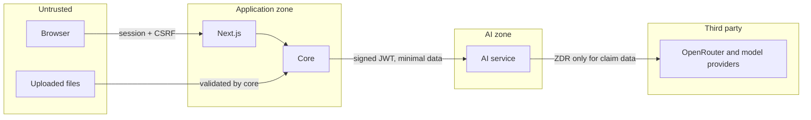

# Security

The security architecture of Prism. This is the target design, and controls become real as milestones deliver them; [progress.md](progress.md) records what exists.

## Trust boundaries

| Boundary | Main threat | Control |
|---|---|---|
| Browser → core | Account takeover, CSRF, XSS, broken access control | Sessions, CSRF tokens, CSP, server-side RBAC and object checks |
| Upload → core | Malicious files | Type, size, and structure validation; no direct serving |
| Core → AI | Forged calls | Signed short-lived JWTs |
| Document text → model | Prompt injection | Documents treated as data; schema-validated output; no tools with side effects |
| AI → providers | Health data exposure | ZDR routing, data minimization, no identifiers in queries |
| Runtime → database | Privilege abuse | Separate least-privilege roles |

## Authentication

- Staff accounts are created by invitation. There is no public registration and no default account.
- The first administrator is created from `PRISM_BOOTSTRAP_ADMIN_EMAIL` through a one-time invitation.
- Failed logins return a generic message, with consistent timing for unknown accounts.
- Progressive throttling applies per account and per IP, and every result is audited.
- Multi-factor authentication (TOTP) arrives in Milestone 9 and is required for privileged roles.

### Passwords

Argon2id, with parameters set to current OWASP guidance and tuned on target hardware. Minimum 12 characters, maximum 128, all characters allowed, with a local common-password blocklist. Parameters upgrade on next login.

### Sessions and tokens

| Setting | Value |
|---|---|
| Storage | Server-side (Spring Session JDBC) |
| Cookie | `HttpOnly`, `Secure` outside local development, `SameSite=Lax`, `__Host-` prefix when deployed |
| Idle timeout | 30 minutes |
| Absolute timeout | 12 hours |
| Rotation | On login and privilege change |
| Revocation | On logout, password change, or role change; admins can end sessions |

Invitation and reset tokens are random, single-use, short-lived, and stored only as hashes.

## Authorization

Authorization is enforced in core at the service layer. Code checks permissions, not roles. Every object access also checks the user's relationship to that object. Frontend visibility is cosmetic only.

| Role | Purpose | Key permissions |
|---|---|---|
| `ADMIN` | User and system administration | Manage users and roles. **No claim decisions** |
| `POLICY_MANAGER` | Policy knowledge | Upload, validate, publish policy versions |
| `CLAIMS_PROCESSOR` | Intake | Create claims, upload documents, respond to information requests |
| `REVIEWER` | Assessment | Review claims, record outcomes within authority |
| `SENIOR_REVIEWER` | Escalations | Reviewer rights, plus escalated and high-value claims |
| `FRAUD_INVESTIGATOR` | Investigation | View risk detail, record investigation findings |
| `AUDITOR` | Oversight | Read-only access to audit trail and evidence |

**Separation of duties:** a user cannot record the outcome for a claim they created, nor publish a policy version they uploaded. Only an investigator can record an investigation finding. Rules are enforced in core and tested.

## API security

- Bean Validation on all inputs, with strict JSON (unknown fields rejected on writes).
- CSRF protection on state-changing requests, and no permissive CORS.
- Throttling on sign-in. Upload limits arrive with uploads in M2.
- Security headers: CSP without `unsafe-eval`, HSTS, `nosniff`, frame denial, strict referrer policy.
- Errors never expose stack traces or internal identifiers.
- The AI service is never exposed publicly.

## Inter-service authentication

1. Core signs each request with an ES256 private key, held only by core.
2. Claims: `iss=prism-core`, `aud=prism-ai`, `iat`, `exp` (at most 60 seconds), `jti`, `sub` (operation), and a SHA-256 hash of the request body.
3. AI verifies the signature with a pinned algorithm, plus `iss`, `aud`, `exp`, and body hash, and rejects anything else with `401`.
4. All `/internal` routes require this; only liveness is exempt.
5. Tokens carry a `kid`, to allow rotation with overlapping keys. The AI service holds one key today; overlap arrives in M9.

Network isolation is an additional layer, never the only one. The same mechanism works locally and when deployed.

## Secrets and configuration

- Secrets come from environment variables or mounted files; deployed environments use a secret manager.
- `.env` and key files are gitignored. `.env.example` has blank values only.
- Services validate configuration at startup, and fail if a required value is missing.
- Secret scanning runs in CI. If a required secret is missing during development, ask the user.

## Database security

| Role | Rights |
|---|---|
| `prism_owner` | DDL. Used only by migrations |
| `prism_core_app` | DML on `core`; only `INSERT` and `SELECT` on `audit_events` |
| `prism_ai_app` | DML on `knowledge`. No access to `core` |
| `prism_audit_reader` | Read-only for audit reporting |

TLS is required on every connection. Queries are parameterized. Neon provides encryption at rest. Backups use Neon's point-in-time restore, with retention set by plan.

## File upload security

- Allowed: PDF, PNG, JPEG, TIFF. Type is detected from content, not from name or client header.
- Size and page limits are configurable (initially 25 MB for claim documents, 50 MB for policies).
- Reject encrypted or malformed files and decompression bombs. Parsing limits and timeouts apply in the AI service.
- Random object keys; original names are stored only as sanitized metadata.
- Download only through authorized endpoints, with `Content-Disposition: attachment` and `nosniff`.
- Malware scanning is added before real-data use (M9).

## AI security

- Document content is untrusted. It can contain instructions meant to steer the model.
- Prompts clearly separate instructions from document data.
- Models have no tools with side effects. Policy Agent tools are read-only and scoped to one policy version.
- Output is schema-validated, and citations are checked against retrieved evidence.
- Injection fixtures are part of the AI test suite, and suspected injection raises a document anomaly indicator.
- Model output is treated as untrusted when rendered in the UI.

## Audit logging

Audited events: authentication, role and user changes, claim creation and changes, document upload, view, and download, policy publication, workflow transitions, AI runs, review actions, outcomes, and denied attempts at sensitive actions.

Each event records actor, role, action, target, result, time, correlation ID, and a minimal change summary. Personal and health values are not copied into audit details.

Protection: written in the business transaction; no `UPDATE` or `DELETE` grants; a trigger blocks changes even for mistakes; per-stream hash chains make tampering detectable; only auditors can read it.

Application logs are separate, and contain IDs but no document content, personal data, tokens, or prompts.

## Data privacy

Claims contain personal and health data.

- **Minimization:** only needed content goes to the AI service and models. Retrieval queries are built from de-identified facts.
- **Providers:** ZDR routing is mandatory ([D-027](decisions.md)).
- **Temporal:** IDs only ([D-011](decisions.md)).
- **Access:** viewing documents is permission-checked and audited.
- **Retention:** configurable, set with the target jurisdiction ([D-035](decisions.md)).

### Privacy gate

Real claim data is prohibited until all of these are complete:

- [ ] DPDP obligations assessed for the India context, along with sector rules (D-043). Prism claims no regulatory compliance until this is formally established
- [ ] Legal review of the OpenRouter and provider data flow, including the ZDR exceptions
- [ ] Required agreements signed with processors
- [ ] Malware scanning, MFA, and backups active
- [ ] Retention and deletion policy implemented
- [ ] Independent security review completed

## Production considerations

TLS everywhere; AI service and Temporal on a private network; managed secrets with rotation; least-privilege service identities; dependency and image scanning; centralized alerting on authentication and audit anomalies; tested backup and restore; separate Neon projects per environment.
