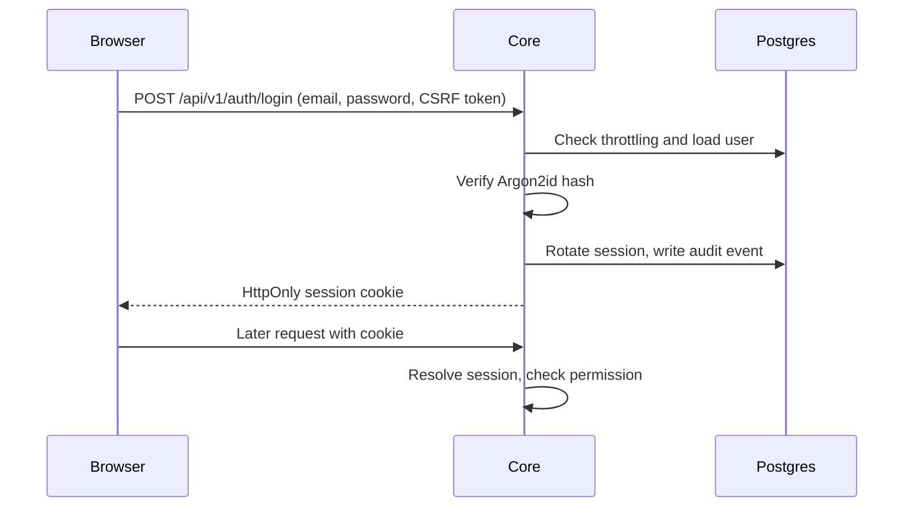
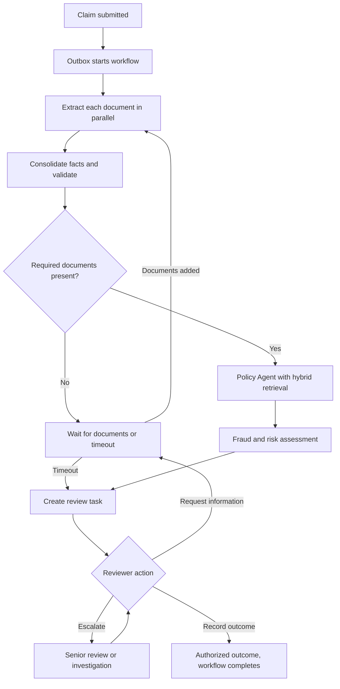
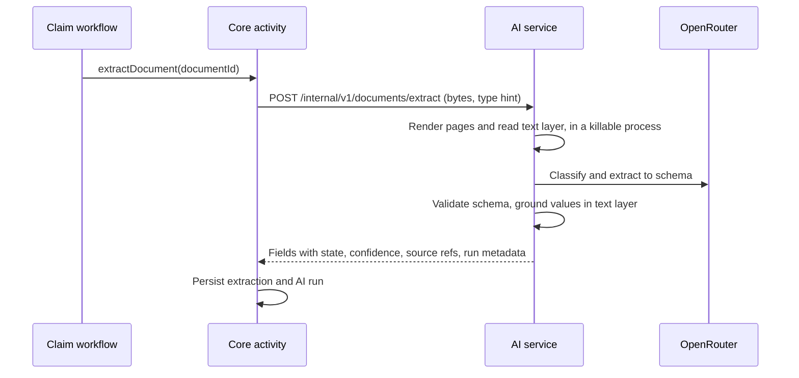
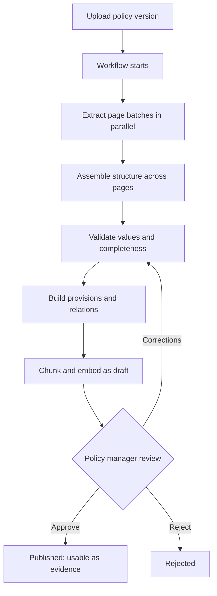
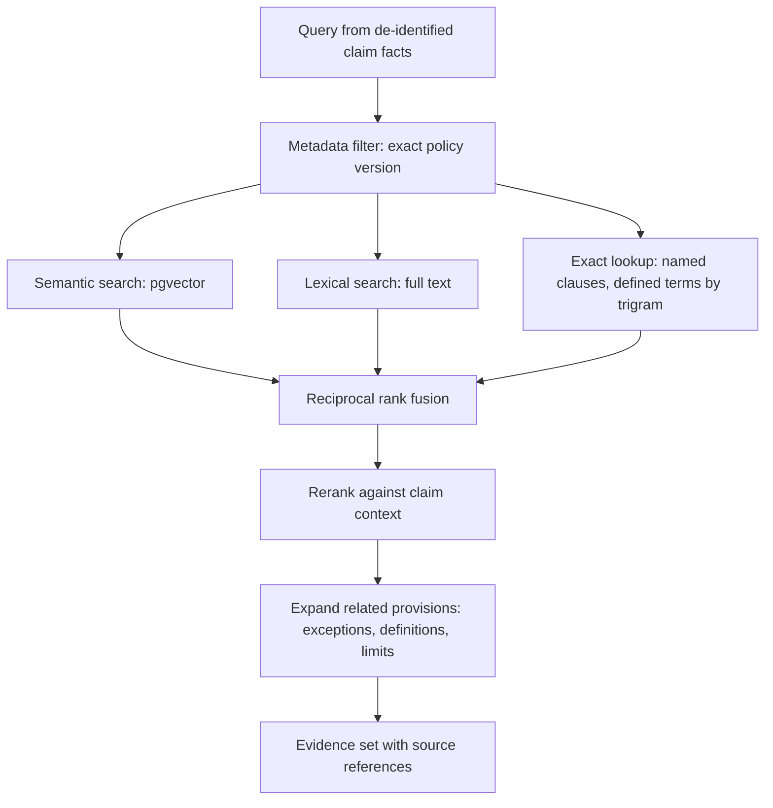
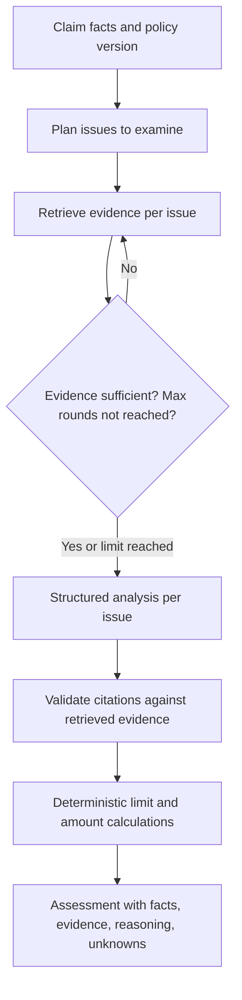
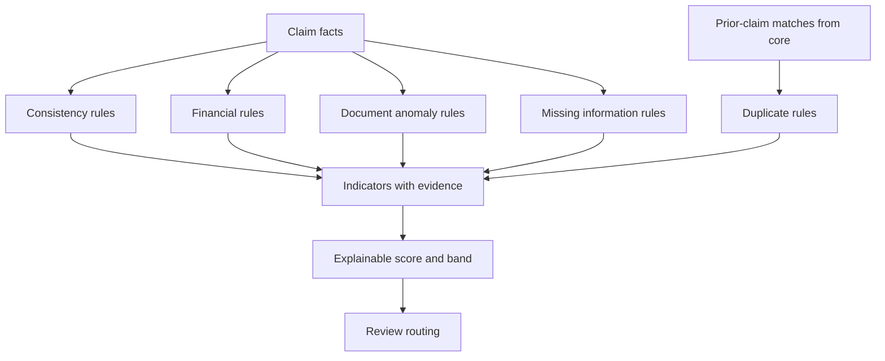
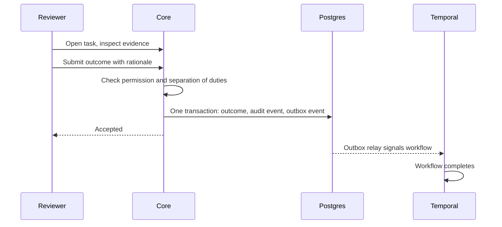
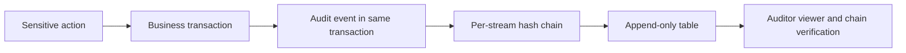
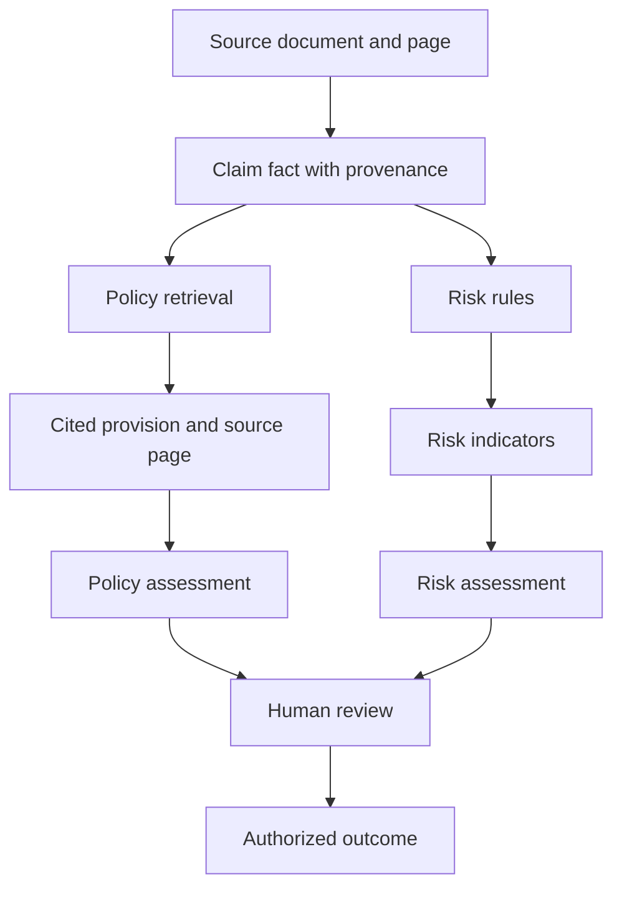

# System Flows

How the major processes run. These describe the target design. For components, see [architecture.md](architecture.md).

## Authentication

Failures return one generic message and are audited. Accounts are created by invitation only.

## Claim processing

Every claim reaches human review, whatever its risk band. A technical failure that exhausts retries moves the stage to `FAILED`, with a retry action for authorized users. It never becomes a claim decision.

### Claim states

| State | Meaning |
|---|---|
| `DRAFT` | Being prepared; no workflow yet |
| `SUBMITTED` | Accepted and queued |
| `PROCESSING` | Automated stages running |
| `AWAITING_INFORMATION` | Waiting for documents or a response |
| `IN_REVIEW` | Assigned to or queued for a human |
| `ESCALATED` | With a senior reviewer or investigator |
| `DECIDED` | Authorized outcome recorded (terminal) |
| `WITHDRAWN` | Closed without a decision (terminal) |

Each stage reports `NOT_STARTED`, `PROCESSING`, `COMPLETED`, `REQUIRES_REVIEW`, or `FAILED`.

## Document extraction

Invalid model output is retried with a stronger route. If it still fails, the document is flagged rather than guessed.

## Policy ingestion

Only `PUBLISHED` versions can be retrieved for a claim. Coverage amounts, limits, waiting periods, and exclusions require explicit human confirmation before publication.

## RAG retrieval

The metadata filter runs first, so evidence from another policy or version cannot appear, and core checks every result belongs to the version it asked about ([D-075](decisions.md)). A failed embedding or rerank is tried once more, then skipped and reported as `degraded` ([D-076](decisions.md)). The index is built when a version is published, by `PolicyIndexingWorkflow`. Expansion matters: an exclusion is incomplete without its exception, and a term without its definition can mislead.

## Policy Agent

An unsupported citation invalidates that finding, which then becomes an unresolved question. The agent never issues a decision, and its analysis never holds a claim from review ([D-080](decisions.md)). Core checks citations against the published version, and computes amounts and dates from confirmed values. As built: [Policy Agent](modules/policy-agent.md).

## Fraud and risk

Core finds cross-claim matches, because AI has no access to claim history, and passes them in. A high band adds scrutiny and routes to an investigator. It never rejects a claim.

## Human review

The database is the record of the decision. The signal is deduplicated by decision ID, so it can be retried safely.

## Audit

An action and its audit record commit or roll back together.

## Evidence chain

From any outcome, a reviewer or auditor can trace back to the exact source pages and AI runs.
